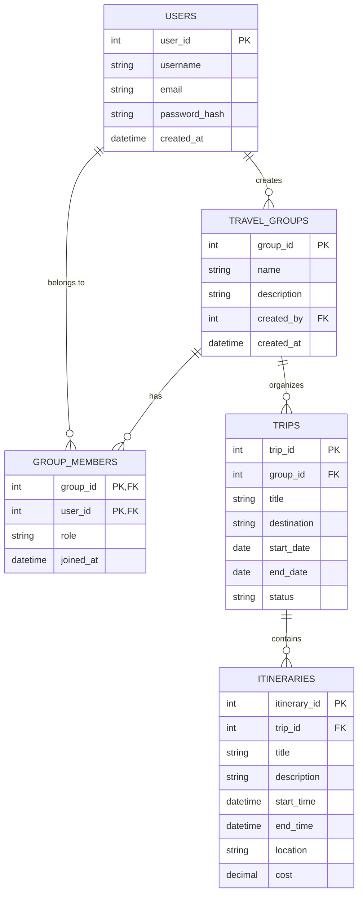

# Group Travel and Itinerary Management System

## Entity-Relationship (ER) Diagram

## Schema Description

1. **USERS**: Stores user accounts.
2. **TRAVEL_GROUPS**: Represents travel groups created by users.
3. **GROUP_MEMBERS**: Junction table mapping users to their respective groups with roles.
4. **TRIPS**: Stores information about specific trips planned by a group.
5. **ITINERARIES**: Represents schedule items/events for a specific trip, and includes the `cost` field for expenses.
