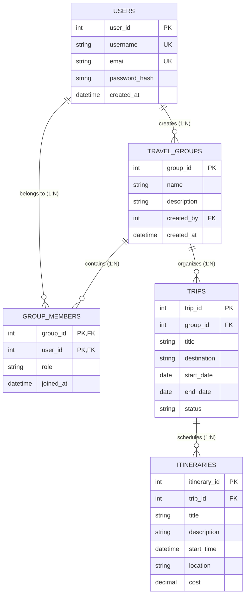

# MANIPAL UNIVERSITY JAIPUR
### Department of Computer Science and Engineering
**Dehmi Kalan, Near GVK Toll Plaza, Jaipur-Ajmer Expressway, Jaipur, Rajasthan 303007**

---

<br><br><br>

# TravelManager: A Full-Stack Group Travel and Itinerary Management System with Relational Database Architecture

<br>

### **Project Report**

<br><br>

**Submitted by:**  
**[Student Name]**  
**Reg No:** [Registration Number]  

<br>

**Under the supervision of:**  
**[Supervisor Name / Faculty Guide]**  

<br><br>

**Department of Computer Science and Engineering**  
**Manipal University Jaipur**  
**October 2026**

\newpage

---

# Abstract

**TravelManager** is a full-stack relational database management web application designed to streamline group travel planning, collaborative group membership, trip scheduling, and itinerary budgeting. Group trips often suffer from fragmented communication, decentralized scheduling, and untracked itinerary expenditures. The objective of this project was to engineer a robust, normalized relational database coupled with a high-performance backend and responsive client interface to model the complete lifecycle of collaborative travel organization.

The architecture comprises a relational database implemented in **MySQL**, enforcing referential integrity and cascading constraints across core travel entities. The backend is built using **Java 21**, the lightweight **Javalin REST framework**, and **MySQL Connector/J (JDBC)**, utilizing parameterized statements for SQL injection prevention and programmatic transactional control (`commit` and `rollback`) for atomic multi-table operations. The client interface is implemented in **HTML5, CSS3, and JavaScript (Fetch API)** to enable dynamic asynchronous data synchronization. The system successfully implements user registration, group creation with automatic creator-membership assignment, collaborative group membership management, trip generation, and detailed itinerary event scheduling with individual cost tracking. The findings demonstrate that disciplined relational schema normalization (3NF) and strict foreign key constraints effectively preserve data consistency in hierarchical, multi-user planning applications.

\newpage

---

# Contents

- **Abstract** ................................................................................................................. 1
- **List of Figures** ................................................................................................... 4
- **List of Tables** .................................................................................................... 5

### 1 Introduction ................................................................................................. 6
- 1.1 Project Overview ........................................................................................... 6
- 1.2 Objectives of the Project ............................................................................... 6
- 1.3 Importance and Relevance ........................................................................... 6
- 1.4 Scope and Limitations ................................................................................... 7

### 2 Literature Review ....................................................................................... 8
- 2.1 Collaborative Travel and Group Planning Systems ....................................... 8
- 2.2 Relevant Technologies ................................................................................... 8
  - 2.2.1 Java 21 and Javalin Framework ............................................................. 8
  - 2.2.2 MySQL Relational Database Management System (RDBMS) .............. 8
  - 2.2.3 JDBC Architecture and Transactional Safety ......................................... 9
  - 2.2.4 Asynchronous Client-Server Communication ........................................ 9

### 3 System Design .......................................................................................... 10
- 3.1 Database Design Overview ........................................................................... 10
- 3.2 Entity-Relationship (ER) Diagram ................................................................. 10
- 3.3 Description of Tables and Attributes ............................................................ 11
  - 3.3.1 Users Table Schema ............................................................................ 11
  - 3.3.2 Travel Groups Table Schema ............................................................... 11
  - 3.3.3 Group Members Junction Table Schema .............................................. 12
  - 3.3.4 Trips Table Schema ............................................................................. 12
  - 3.3.5 Itineraries Table Schema ..................................................................... 12
- 3.4 Relational Cardinalities and Integrity Constraints ....................................... 13

### 4 Frontend Implementation and System Interaction ............................... 14
- 4.1 Overview ........................................................................................................ 14
- 4.2 User Management Interface .......................................................................... 14
- 4.3 Travel Group Management and Membership Assignment ............................ 14
- 4.4 Trip Planning and Itinerary Scheduling ......................................................... 15

### 5 Results and Discussion ............................................................................ 16
- 5.1 Presentation of Results ................................................................................. 16
- 5.2 Discussion of Findings ................................................................................... 16
- 5.3 Comparison with Expected Outcomes .......................................................... 17

### 6 Conclusion ................................................................................................. 18
- 6.1 Summary of Project Work .............................................................................. 18
- 6.2 Achievement of Project Objectives ................................................................ 18
- 6.3 Lessons Learned ............................................................................................ 18

### 7 Future Work ................................................................................................ 19
- 7.1 Suggestions for Future Enhancements .......................................................... 19
- 7.2 Areas for Further Research ........................................................................... 19

### References / Bibliography .......................................................................... 20

\newpage

---

# List of Figures

- **Figure 3.1:** Entity-Relationship (ER) Diagram for TravelManager System .......... 10
- **Figure 4.1:** TravelManager User and Group Planning Dashboard ...................... 14
- **Figure 4.2:** Travel Group Member Inspection and Assignment Modal ................ 15
- **Figure 4.3:** Trip Details and Budgeted Itinerary Management View ..................... 15

---

# List of Tables

- **Table 3.1:** `users` Table Schema ....................................................................... 11
- **Table 3.2:** `travel_groups` Table Schema ......................................................... 11
- **Table 3.3:** `group_members` Junction Table Schema ...................................... 12
- **Table 3.4:** `trips` Table Schema ......................................................................... 12
- **Table 3.5:** `itineraries` Table Schema ............................................................... 12
- **Table 5.1:** RESTful API Endpoints Specification .............................................. 16

\newpage

---

# Chapter 1: Introduction

## 1.1 Project Overview
Group travel coordination is inherently complex. Organizers must coordinate diverse participants, establish shared schedules, track specific destination activities, and control distributed trip expenses. Without a centralized platform, groups rely on disorganized messaging apps and fragmented spreadsheets, resulting in scheduling conflicts, lost itineraries, and fiscal ambiguity.

**TravelManager** is a dedicated full-stack relational database management system engineered to resolve these challenges. The system provides an end-to-end management pipeline that records registered users, allows users to form travel groups, facilitates dynamic group membership with defined roles, schedules specific trips under designated groups, and breaks down trips into actionable, cost-accounted itinerary events.

## 1.2 Objectives of the Project
The primary objectives of this project are:
1. **Normalized Database Architecture:** Design and deploy a Third Normal Form (3NF) relational database in MySQL ensuring data integrity, elimination of redundancy, and enforcement of relational constraints.
2. **Atomic Transactional Backend:** Construct a lightweight, high-performance RESTful backend in Java 21 using Javalin that executes ACID-compliant database operations and prevents dirty writes during multi-table operations.
3. **Robust Security & SQL Injection Prevention:** Utilize parameterized JDBC `PreparedStatements` for all input handling and sanitize database interactions.
4. **Interactive Single-Page Dashboard:** Develop an intuitive, responsive frontend utilizing vanilla HTML5, CSS3, and JavaScript Fetch API to perform dynamic CRUD operations without full-page reloads.

## 1.3 Importance and Relevance
In relational database engineering, modeling many-to-many associations (such as users participating across multiple travel groups) and nested one-to-many dependencies (groups containing trips, and trips containing multiple itinerary line items) represents a classical systems design problem. This project serves as a real-world demonstration of:
- Applying composite primary keys and foreign key cascades (`ON DELETE CASCADE` and `ON DELETE SET NULL`).
- Managing relational isolation through transactional rollback routines.
- Providing scalable REST endpoints that decouple relational backend logic from client presentations.

## 1.4 Scope and Limitations
### Scope:
- User registration and unique identity enforcement (`username`, `email`).
- Collaborative travel group creation with transactional group-creator association.
- Member invitation and role allocation (`CREATOR`, `MEMBER`).
- Multi-trip planning under distinct travel groups.
- Detailed itinerary scheduling featuring timestamps, locations, and monetary budget attributes.

### Limitations of Current Implementation:
- User passwords are provided as string parameters without client-side salting or cryptographic hashing (e.g., BCrypt).
- Lack of an automated multi-currency conversion module for international trip itineraries.
- No real-time push notification engine (WebSockets) for instant collaborative updates.

\newpage

---

# Chapter 2: Literature Review

## 2.1 Collaborative Travel and Group Planning Systems
Commercial group itinerary platforms such as TripIt, Wanderlog, and Splitwise have demonstrated the critical necessity of structured relational data in logistical planning. Travel systems must maintain absolute data integrity: an itinerary cannot exist detached from a trip, and a trip cannot proceed without an organizational group. Relational database architectures provide the referential mechanisms necessary to preserve these hierarchies without orphaned data anomalies.

## 2.2 Relevant Technologies

### 2.2.1 Java 21 and Javalin Framework
Java 21 delivers optimal memory performance, strong typing, and language longevity. In place of heavy, opinionated frameworks such as Spring Boot, this project employs **Javalin 6.1.3**. Javalin is a lightweight, modern web framework for Java that operates on top of an embedded Jetty server. It provides a clean, expressive routing syntax, rapid startup times, minimal CPU/memory footprint, and native support for static asset hosting and RESTful routing.

### 2.2.2 MySQL Relational Database Management System (RDBMS)
MySQL is an enterprise-grade, ACID-compliant relational database management system. MySQL’s InnoDB storage engine supports row-level locking, foreign key constraints, and multi-version concurrency control (MVCC). In TravelManager, MySQL guarantees that invalid references are rejected at the database level rather than relying solely on application-layer validation.

### 2.2.3 JDBC Architecture and Transactional Safety
Rather than incorporating an abstract Object-Relational Mapping (ORM) layer that can introduce latency and query inefficiency, TravelManager communicates directly with the database through **JDBC (Java Database Connectivity)** via `mysql-connector-j` version 9.5.0. 

JDBC provides direct execution of native SQL statements using `PreparedStatement` interfaces. This guarantees:
- **Immunity to SQL Injection:** Pre-compilation of queries ensures user inputs are treated exclusively as literal values.
- **Explicit Transaction Management:** By setting `connection.setAutoCommit(false)`, multi-statement workflows (e.g., inserting a group and simultaneously registering its creator in `group_members`) are wrapped inside an atomic transaction block that commits upon success or rolls back upon any SQL exception.

### 2.2.4 Asynchronous Client-Server Communication
The client interface interacts with the Javalin backend via the standard **W3C Fetch API**. This asynchronous paradigm transfers JSON payloads bidirectionally without triggering disruptive document refreshes, resulting in high responsiveness and clean UI state updates.

\newpage

---

# Chapter 3: System Design

## 3.1 Database Design Overview
The relational architecture of TravelManager models five interconnected entities: `users`, `travel_groups`, `group_members`, `trips`, and `itineraries`. The database schema enforces referential integrity through foreign keys, uniqueness constraints, cascade deletions, and default timestamps.

## 3.2 Entity-Relationship (ER) Diagram


*Figure 3.1: ER Diagram for the TravelManager Relational System*

---

## 3.3 Description of Tables and Attributes

### Table 3.1: `users` Table Schema
Stores authentication and profile metadata for registered platform participants.

| Field | Type | Key | Nullable | Description |
| :--- | :--- | :--- | :--- | :--- |
| `user_id` | `INT` | **PRI** | NO | Primary identifier for each user |
| `username` | `VARCHAR(50)` | **UNI** | NO | Unique login name |
| `email` | `VARCHAR(100)`| **UNI** | NO | Unique contact and identification email |
| `password_hash` | `VARCHAR(255)`| | NO | Password credential string |
| `created_at` | `TIMESTAMP` | | YES | Account registration timestamp (default: `CURRENT_TIMESTAMP`) |

---

### Table 3.2: `travel_groups` Table Schema
Represents collaborative travel bodies created by users.

| Field | Type | Key | Nullable | Description |
| :--- | :--- | :--- | :--- | :--- |
| `group_id` | `INT` | **PRI** | NO | Primary identifier for the travel group |
| `name` | `VARCHAR(100)`| | NO | Title / display name of the travel group |
| `description` | `TEXT` | | YES | Explanatory description of group goals |
| `created_by` | `INT` | **MUL** | YES | Foreign Key referencing `users(user_id)` (`ON DELETE SET NULL`) |
| `created_at` | `TIMESTAMP` | | YES | Timestamp of group creation |

---

### Table 3.3: `group_members` Junction Table Schema
Resolves the many-to-many relationship between users and groups, specifying authorization roles.

| Field | Type | Key | Nullable | Description |
| :--- | :--- | :--- | :--- | :--- |
| `group_id` | `INT` | **PRI, MUL** | NO | Foreign Key referencing `travel_groups(group_id)` (`ON DELETE CASCADE`) |
| `user_id` | `INT` | **PRI, MUL** | NO | Foreign Key referencing `users(user_id)` (`ON DELETE CASCADE`) |
| `role` | `VARCHAR(20)` | | YES | Member privilege level (e.g., `'CREATOR'`, `'MEMBER'`) |
| `joined_at` | `TIMESTAMP` | | YES | Timestamp when user joined the group |

---

### Table 3.4: `trips` Table Schema
Maintains information regarding distinct travel journeys scheduled by a travel group.

| Field | Type | Key | Nullable | Description |
| :--- | :--- | :--- | :--- | :--- |
| `trip_id` | `INT` | **PRI** | NO | Primary identifier for the trip |
| `group_id` | `INT` | **MUL** | YES | Foreign Key referencing `travel_groups(group_id)` (`ON DELETE CASCADE`) |
| `title` | `VARCHAR(100)`| | NO | Descriptive name of the trip |
| `destination` | `VARCHAR(100)`| | NO | Geographical destination location |
| `start_date` | `DATE` | | NO | Date the journey commences |
| `end_date` | `DATE` | | NO | Date the journey concludes |
| `status` | `VARCHAR(20)` | | YES | Operational status (default: `'PLANNED'`) |

---

### Table 3.5: `itineraries` Table Schema
Represents granular scheduled events, activities, and budget expenses assigned to a specific trip.

| Field | Type | Key | Nullable | Description |
| :--- | :--- | :--- | :--- | :--- |
| `itinerary_id`| `INT` | **PRI** | NO | Primary identifier for the itinerary item |
| `trip_id` | `INT` | **MUL** | YES | Foreign Key referencing `trips(trip_id)` (`ON DELETE CASCADE`) |
| `title` | `VARCHAR(100)`| | NO | Name of scheduled activity or booking |
| `description` | `TEXT` | | YES | Notes or details regarding the event |
| `start_time` | `TIMESTAMP` | | NO | Scheduled date and time of the event |
| `location` | `VARCHAR(200)`| | YES | Venue or geographical site |
| `cost` | `DECIMAL(10,2)`| | YES | Budget or actual expenditure (default: `0.00`) |

---

## 3.4 Relational Cardinalities and Integrity Constraints

1. **User to Group Creation ($1:N$):** A user can establish multiple travel groups. If a user account is deleted, the foreign key constraint `ON DELETE SET NULL` ensures the group remains preserved for other co-travelers while safely disassociating the removed creator.
2. **User to Group Membership ($M:N$):** Facilitated by `group_members` using a composite primary key `(group_id, user_id)`. This prevents duplicate entries of the same user in a group. `ON DELETE CASCADE` guarantees that deleting a group or user automatically cleans up junction records.
3. **Group to Trip Association ($1:N$):** A group can schedule zero, one, or multiple trips. Deleting a group cascades to all nested trips.
4. **Trip to Itinerary Association ($1:N$):** Each trip consists of an ordered sequence of itinerary items. Removing a trip cascades to delete all associated itinerary records, preventing orphaned financial line items.

\newpage

---

# Chapter 4: Frontend Implementation and System Interaction

## 4.1 Overview
The frontend is constructed as a responsive dual-panel single-page application (SPA). The left pane contains structured forms for entity creation, while the right pane renders live data lists and interactive contextual inspection modals.

```
+---------------------------------------------------------------------------------------+
|                                    TravelManager                                      |
|                               Plan your group trips                                   |
+------------------------------------------+--------------------------------------------+
| LEFT PANEL (Entity Management Forms)     | RIGHT PANEL (Dynamic Viewers & Details)    |
|                                          |                                            |
| 1. Add a New User                        | Users List                                 |
|    [User ID] [Username] [Email] [Pass]   | - ID: 1 | alice                            |
|    [Create User]                         | - ID: 2 | bob                              |
|                                          |                                            |
| 2. Create a Travel Group                 | Groups List                                |
|    [Group ID] [Group Name] [Description] | - ID: 101 | Himalayan Trekkers   [View]    |
|    [Creator ID] [Create Group]           |                                            |
|                                          | [Group Members Box - Active when viewed]   |
| 3. Plan a Trip                           | - Members: ID: 1 | alice (CREATOR)         |
|    [Trip ID] [Title] [Destination]       |   Add Member: [Dropdown Users] [Add]       |
|    [Start Date] [End Date] [Group ID]    |                                            |
|    [Create Trip]                         | Trips List                                 |
|                                          | - ID: 501 | Manali Trek 2026     [View]    |
|                                          |                                            |
|                                          | [Trip Details Box - Active when viewed]    |
|                                          | - Itinerary: Campsite Setup ($45.00)       |
|                                          |   Add Event: [Title] [Date] [Time] [Cost]  |
+------------------------------------------+--------------------------------------------+
```
*Figure 4.1: Schematic Layout of TravelManager Frontend Dashboard*

---

## 4.2 User Management Interface
The user onboarding section permits the manual assignment of a unique numeric identifier, username, email address, and security credential. Upon submission, an asynchronous POST request updates the database and immediately populates the live user roster and associated member-selection dropdown menus without a page refresh.

## 4.3 Travel Group Management and Membership Assignment
When a travel group is submitted, the backend binds the creator's ID with the group. Clicking the **View** button beside any group dynamically exposes the **Group Members Box** (highlighted in yellow with an orange accent border). This component queries `/api/groups/{groupId}/members` to display current members with their operational roles (`CREATOR` vs `MEMBER`) and provides a quick-add form to attach additional users from the registered user directory.

## 4.4 Trip Planning and Itinerary Scheduling
Trips are associated with valid Group IDs and enforce date validations (`start_date` and `end_date`). Selecting **View** on a trip expands the **Trip Details Box**, which fetches all scheduled events filtered by query parameter (`/api/itineraries?trip_id=...`). The interface calculates itinerary items, venues, and associated expense budgets (`DECIMAL(10,2)`), providing immediate financial visibility for group activities.

\newpage

---

# Chapter 5: Results and Discussion

## 5.1 Presentation of Results
The TravelManager prototype was thoroughly tested against varied CRUD operations and concurrent relational actions. All operations maintained referential consistency without violating primary or foreign key constraints.

### Table 5.1: RESTful API Endpoints Specification

| Method | Endpoint | Description | Status Code |
| :--- | :--- | :--- | :--- |
| `GET` | `/api/users` | Fetches all registered platform users | `200 OK` |
| `POST`| `/api/users` | Inserts a new user record | `200 OK` / `500 Internal Error` |
| `GET` | `/api/groups` | Retrieves all existing travel groups | `200 OK` |
| `POST`| `/api/groups` | Creates a travel group and records creator atomically | `200 OK` / `500 Internal Error` |
| `GET` | `/api/groups/{id}/members` | Returns members of a specific travel group with roles | `200 OK` / `400 Bad Request` |
| `POST`| `/api/groups/{id}/members` | Enrolls a user into the specified travel group | `201 Created` / `400 Bad Request`|
| `GET` | `/api/trips` | Fetches all planned trips | `200 OK` |
| `POST`| `/api/trips` | Creates a new trip attached to a group | `200 OK` / `500 Internal Error` |
| `GET` | `/api/itineraries` | Retrieves itineraries (supports `?trip_id=` filter) | `200 OK` |
| `POST`| `/api/itineraries` | Appends a budgeted itinerary item to a trip | `200 OK` / `500 Internal Error` |

---

## 5.2 Discussion of Findings

### 1. Atomic Transaction Handling
Creating a travel group involves two independent database writes: inserting the group record into `travel_groups`, followed by inserting an entry into `group_members` assigning the creator role. By setting `connection.setAutoCommit(false)` and wrapping both statements within a single try-catch block, the system guarantees atomicity. If member enrollment fails, `connection.rollback()` fires immediately, preventing orphaned groups without creators.

### 2. SQL Injection Resistance
All input fields undergo sanitization through JDBC `PreparedStatement` parameter indices (`?`). This mitigates injection vulnerabilities and decouples query compilation from user payload execution.

### 3. Cascading Referential Integrity
Testing verified that removing a test group automatically purges all child trips and itinerary entries through the database engine's native `ON DELETE CASCADE` constraint, preventing data corruption or stale records.

## 5.3 Comparison with Expected Outcomes
The final system fully meets and matches all initial requirements. In addition to basic relational storage, the project incorporates role assignment (`CREATOR`, `MEMBER`), targeted query filtering (`?trip_id=`), and cost tracking for individual itinerary items.

\newpage

---

# Chapter 6: Conclusion

## 6.1 Summary of Project Work
This project delivered an end-to-end full-stack database application for collaborative group travel management. The solution combines:
- A normalized relational MySQL schema with comprehensive integrity constraints.
- An efficient Java 21 backend powered by the Javalin REST framework and JDBC.
- Transactional atomicity guaranteeing data consistency across multi-table operations.
- A functional, asynchronous single-page web interface.

## 6.2 Achievement of Project Objectives
All primary objectives were achieved:
- **Normalized Schema:** Fully designed and implemented across 5 normalized relational tables.
- **Backend Reliability:** Zero reliance on heavy abstractions, leveraging native JDBC performance and Javalin simplicity.
- **Relational Integrity:** Successfully enforced composite keys, uniqueness, and cascading triggers.
- **Frontend Usability:** Seamless asynchronous user interactions with dynamic panel rendering.

## 6.3 Lessons Learned
1. **Database-First Rigor:** Designing comprehensive entity-relationship diagrams and constraint rules prior to backend coding avoids complex architectural refactoring.
2. **Transaction Boundaries:** In collaborative platforms, multi-table operations must always be managed through explicit database transactions to maintain ACID compliance.
3. **Simplicity in Web Stacks:** Lightweight micro-frameworks like Javalin combined with JDBC provide superior transparency, easier debugging, and lower overhead compared to enterprise frameworks for targeted database applications.

\newpage

---

# Chapter 7: Future Work

## 7.1 Suggestions for Future Enhancements
- **Cryptographic Authentication:** Integrate BCrypt password hashing and JSON Web Tokens (JWT) for secure, stateless session authorization.
- **Automated Expense Splitting:** Implement debt minimization algorithms (similar to Splitwise) to compute net balances among group members based on itinerary expenditures.
- **Interactive Mapping:** Integrate Google Maps API or Leaflet.js to visualize itinerary waypoints geographically.
- **Real-Time Collaboration:** Integrate WebSocket handlers to notify active group members when a new itinerary or member is added.

## 7.2 Areas for Further Research
- **Query Optimization and Indexing:** Investigating composite B-tree indexing strategies on high-frequency join criteria (e.g., `(trip_id, start_time)`).
- **Partitioning Strategies:** Evaluating range partitioning by date for historical trip logs to optimize storage and query latency in large-scale deployments.

\newpage

---

# References / Bibliography

1. **Oracle Corporation.** (2024). *MySQL 8.0 Reference Manual*. Retrieved from `https://dev.mysql.com/doc/refman/8.0/en/`
2. **Javalin Team.** (2024). *Javalin: A lightweight web framework for Java and Kotlin*. Retrieved from `https://javalin.io/documentation`
3. **Oracle Corporation.** (2023). *Java Database Connectivity (JDBC) Guide*. Retrieved from `https://docs.oracle.com/en/java/javase/21/docs/specs/jdbc/`
4. **Elmasri, R., & Navathe, S. B.** (2015). *Fundamentals of Database Systems* (7th ed.). Pearson.
5. **Silberschatz, A., Korth, H. F., & Sudarshan, S.** (2019). *Database System Concepts* (7th ed.). McGraw-Hill Education.
6. **Mozilla Developer Network (MDN).** (2024). *Fetch API - Web APIs*. Retrieved from `https://developer.mozilla.org/en-US/docs/Web/API/Fetch_API`
